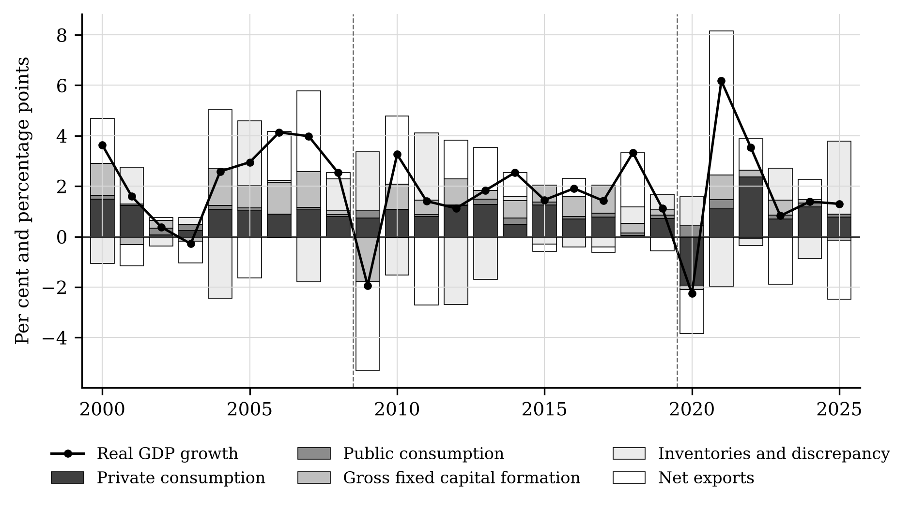

# The Demand and Growth Regime of Switzerland

Data and code behind Tables 1 to 4 and Figures 1 to 3 of

> Aslan, I. (2026). The demand and growth regime of Switzerland: Export-led mercantilism under safe-haven pressure. Working paper. [SSRN 7405738](https://ssrn.com/abstract=7405738)



Switzerland runs one of the largest and most persistent current account surpluses among advanced economies. It combines a constitutional fiscal rule with the highest household debt ratio in the OECD, and defends a floating safe-haven currency with a central bank balance sheet that came to exceed annual output. Applying the post-Keynesian classification of demand and growth regimes to 2000–2025, the paper finds that Switzerland has been export-led mercantilist throughout. The finding rests on sectoral financial balances, growth contributions and a supermultiplier decomposition of autonomous demand. Where the German variant rested on wage restraint inside a currency union, the Swiss variant has required continuous central-bank absorption of appreciation pressure.

## Main results

Supermultiplier decomposition of real GDP growth (Table 3, percentage points a year):

| | 2001–2008 | 2009–2019 | 2020–2025 |
|---|---|---|---|
| Exports | 2.8 | 1.7 | 2.2 |
| Change in propensity to import | −0.7 | −0.5 | −0.8 |
| Change in propensity to consume | −0.4 | −0.1 | −0.4 |
| Real GDP growth | 2.2 | 1.6 | 1.8 |
| Share of exports in autonomous contributions (%) | 90 | 81 | 83 |
| Supermultiplier (end of period) | 1.19 | 1.12 | 1.03 |

Exports are the dominant autonomous component in every subperiod. Households run growing surpluses (8.8, 10.4 and 12.1 per cent of GDP) while corporations are net borrowers (Table 2).

## Files

| File | Content |
|---|---|
| `assemble_data.py` | The annual series, Switzerland 1998–2025, transcribed from the source APIs with the source and series code of each; writes `macro.csv` and `data.csv` |
| `macro.csv` | All series, one row per year |
| `data.csv` | Input of `ssm_decomposition.py`: real GDP and its components at 2020 prices, GDP deflator, household credit stock, household and government shares of gross fixed capital formation |
| `ssm_decomposition.py` | Growth contributions (Table 2, Figure 1) and the supermultiplier decomposition (Table 3), annual and by subperiod, with the dominance rule of Campana and Hein (2026) |
| `germany_nx.py` | Net-export growth contributions for Germany with the same method (Table 4) |
| `make_tables.py` | Period averages and point values behind Tables 1, 2 and 4 and the figures quoted in the text |
| `plot_figures.py` | Figures 1 to 3 |
| `results/` | Outputs: `nifa_annual.csv`, `nifa_periods.csv` (Table 2); `ssm_annual_baseline.csv`, `ssm_periods_baseline.csv`, `ssm_periods_all_variants.csv` (Table 3); `germany_annual.csv`, `germany_periods.csv` (Table 4); `tables.txt` (output of `make_tables.py`); `figure1.png` to `figure3.png` |

## Running the code

```
python -m pip install -r requirements.txt
python assemble_data.py
python ssm_decomposition.py data.csv --out results --periods 2000-2008 2009-2019 2020-2025 2000-2007 2011-2019
python germany_nx.py
python make_tables.py > results/tables.txt
python plot_figures.py
```

Run the scripts from the repository folder; together they take a few seconds and reproduce every file in `results/` exactly. They were last checked with Python 3.13, pandas 3.0, NumPy 2.5 and Matplotlib 3.11.

## Method

**Growth contributions (Table 2, Figure 1).** The change in each component at 2020 prices is divided by the previous year's GDP. Inventories and the statistical discrepancy are closed as the residual, so that the contributions sum to measured growth. Period averages are simple means of the annual values. The first subperiod of the supermultiplier decomposition starts in 2001 because the credit flow needs a lagged stock.

**Supermultiplier decomposition (Table 3).** The baseline follows Campana and Hein (2026). Credit-financed consumption is the real net flow of credit to households: the BIS stock in per cent of GDP, times nominal GDP, deflated. Residential and government investment apply the household and government shares of gross fixed capital formation in the Eurostat sector accounts to real gross fixed capital formation; the 2023 shares are carried forward to 2024–2025. Exports and government consumption are from the national accounts. Consumption out of income is private consumption less its credit-financed part. Business investment is total investment less its household and government parts. The script also accepts a consumer-credit stock (variant A) and a dwellings-investment series (variant B). Neither was available from the harmonised sources used, so these columns are empty in `data.csv` and only the baseline is computed. The identity Y = μ(Z + E) holds in every year.

**Table 1 and Section 3.** The real short-term rate is the OECD short-term interest rate less CPI inflation. The cyclically adjusted primary balance and the output gap are from the OECD Economic Outlook. General government net lending, public investment, compensation of employees and the household saving rate are from the Eurostat sector accounts, and nominal unit labour costs from Eurostat. Export and import shares, the REER and the CPI are from the WDI. The balance-sheet row and the economic complexity ranks are taken from the SNB annual reports and the Atlas of Economic Complexity, as cited in the paper, and are not computed here.

**Table 4.** German net-export contributions use World Bank WDI NY.GDP.MKTP.KN, NE.EXP.GNFS.KN and NE.IMP.GNFS.KN with the method of Table 2.

## Data

World Bank World Development Indicators (July 2026 vintage), Eurostat sector and national accounts, OECD Economic Outlook, BIS credit to the non-financial sector (via FRED) and Penn World Table 10.01 (via FRED), retrieved 25–26 September 2026. `assemble_data.py` lists the series code of every variable.

## Citation

Please cite the paper. GitHub's "Cite this repository" button gives the reference in APA and BibTeX formats.

## Licence

Code: MIT licence (see `LICENSE`). The data are from the public sources listed above.

## Author

Ilker Aslan, Lecturer, Kalaidos University of Applied Sciences, Zürich
[ORCID 0000-0001-9241-9420](https://orcid.org/0000-0001-9241-9420) · [ilkeraslan.github.io](https://ilkeraslan.github.io)
